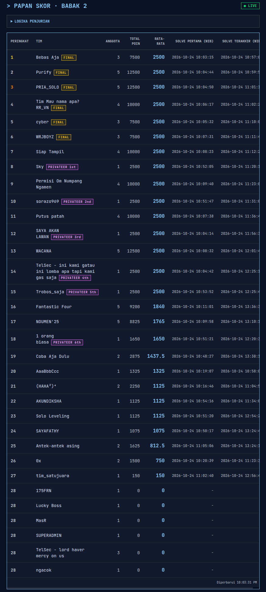
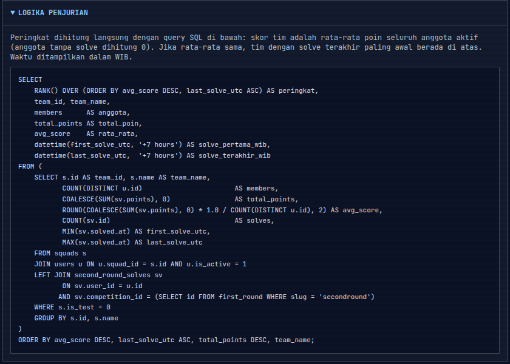

# 🏆 Hackathon UNDANA — Hasil Akhir & Dasbor Telemetri

Pertempuran babak final telah selesai. Selama lebih dari dua jam nonstop, kluster server panitia digempur oleh lalu lintas masif dari seluruh tim finalis. Menembus babak final dan menjalankan skrip _stress-testing_ skala masif di lingkungan infrastruktur nyata adalah bukti kompetensi teknis tingkat tinggi. Setiap tim yang bertanding hari ini berhasil menguji batas ketahanan sistem kami hingga titik kritis (_network saturation_, antrean memori penuh, dan _packet shedding_).

Di bawah ini adalah rekapitulasi performa, metrik resmi, transparansi logika kalkulasi, serta panduan menjalankan dasbor telemetri mandiri.

## 🎖️ Klasemen Akhir & Rekapitulasi Performa
Setiap finalis menunjukkan spesialisasi dan efisiensi serang yang berbeda di medan tempur. Dari ratusan miliar paket data yang melintasi antarmuka jaringan kami, seluruh tim di panggung final menorehkan jejak telemetri yang signifikan:

|**Peringkat**|**Tim**|**Skor Akhir**|**Total Request**|**Data Tertulis**|**Sorotan Taktis & Keunggulan**|
|---|---|---|---|---|---|
|🥇 **Juara 1**|**cyber** (`team5`)|**100,00**|322,5 Miliar|4,19 TB|_Absolute Throughput_ — Volume saturasi terbesar dan penguasaan _socket_ terpanjang.|
|🥈 **Juara 2**|**WRJBOYZ**|**62,00**|200,3 Miliar|2,60 TB|_High-Density Assault_ — Konkurensi agresif berlatensi rendah yang memicu lonjakan I/O server.|
|🥉 **Juara 3**|**PRIA_SOLO** (`PRIASOLO`)|**11,33**|35,9 Miliar|466 GB|_Sustained Persistence_ — Penguncian soket stabil dan pemanfaatan koneksi efektif.|
|🎖️ **Finalis Top 4**|**Purify**|**1,85**|Terbaca di Log|Terbaca di Log|_Precision Targeting_ — Eksploitasi target terfokus dengan payload terstruktur rapi.|
|🎖️ **Finalis Top 5**|**Tim Mau nama apa? RR_VN**|**0,14**|Terbaca di Log|Terbaca di Log|_Adaptive Probing_ — Ketahanan eksekusi skrip dinamis menghadapi mitigasi server.|
|🎖️ **Finalis Top 6**|**Bebas Aja** (`7`)|**0,02**|Terbaca di Log|Terbaca di Log|_Stealth Execution_ — Upaya penetrasi konstan pada rute-rute pengujian spesifik.|

> **Catatan Teknis Panitia:** Masuk ke jajaran finalis berarti skrip, arsitektur _multithreading_, dan alur koneksi tim Anda berhasil mengeksekusi _pipeline_ jaringan di bawah tekanan sistem sungguhan. Angka di atas mencerminkan skor relatif terhadap parameter beban puncak hari ini.

## 🌟 Honorable Mention: Bebas Aja

Panitia memberikan _honorable mention_ kepada tim **Bebas Aja**, peringkat 6 pada klasemen resmi babak final (skor 0,02). Tim ini juga menempati **peringkat 1 pada Papan Skor Babak 2** (lihat bagian di bawah), sehingga kemampuannya jelas tidak diragukan. Menurut analisis panitia, Bebas Aja **seharusnya dapat menempati peringkat 5** seandainya berhasil menebak format header yang diminta server.

**Apa yang terjadi?** Identitas tim dibaca server dari header `X-Team-Id`. Server hanya menerima nilai yang terdiri dari 1 sampai 64 karakter ASCII yang dapat dicetak **tanpa spasi**. Nama tim **"Bebas Aja"** mengandung spasi, sehingga lalu lintasnya dicatat sebagai `unknown`, lalu disaring keluar dari penilaian sesuai aturan sanitasi log (bagian _Integritas Data_, poin 2). Aturan "tanpa spasi" ini tidak dinyatakan secara eksplisit dalam petunjuk untuk peserta, sehingga hampir mustahil ditebak tanpa mencoba berbagai format.

**Seberapa dekat?** Berikut hitungan simulasi dengan rumus dan bobot yang sama seperti klasemen resmi:

|**Keterangan**|**Nilai**|
|---|---|
|Skor resmi Bebas Aja (tag `7`)|0,02|
|Skor peringkat 5 (RR_VN)|0,14|
|Skor peringkat 4 (Purify)|1,85|
|Total lalu lintas `unknown` (seluruh tim, tidak bisa dipisahkan per tim)|1,21 miliar request, 15,8 GB data tertulis|
|Bagian dari `unknown` yang cukup untuk melewati RR_VN|sekitar 25,5% (± 310 juta request)|
|Skor tertinggi yang mungkin (jika seluruh `unknown` dihitung untuk Bebas Aja)|sekitar 0,49|

Artinya, Bebas Aja cukup memiliki seperempat dari lalu lintas `unknown` untuk naik ke peringkat 5. Sebaliknya, bahkan jika seluruh lalu lintas `unknown` dihitung untuk mereka, skornya (± 0,49) tetap di bawah Purify (1,85), sehingga **peringkat 5 adalah batas tertinggi yang mungkin**.

> **Catatan:** Lalu lintas `unknown` tidak dapat dipetakan ke tim tertentu, jadi angka di atas adalah simulasi, bukan klasemen resmi. **Klasemen resmi tidak diubah.** Penghargaan ini diberikan sebagai bentuk apresiasi atas usaha tim.

## 📋 Hasil Babak 2

Hasil babak 2 tersedia di repositori ini, di direktori yang sama dengan `README.md`:

|**Berkas**|**Isi**|
|---|---|
|[`SKOR-BABAK-2.png`](SKOR-BABAK-2.png)|Papan skor babak 2: peringkat, nama tim, jumlah anggota, total poin, rata-rata poin, serta waktu _solve_ pertama dan terakhir (WIB). Label **FINAL** menandai tim yang melaju ke babak final.|
|[`LOGIKA-PENJURIAN-BABAK-2.png`](LOGIKA-PENJURIAN-BABAK-2.png)|Logika penjurian babak 2 beserta _query_ SQL yang dipakai untuk menghitung peringkat.|

**Papan Skor Babak 2**



**Logika Penjurian Babak 2**



Ringkasan logika penjurian babak 2 (selengkapnya, termasuk _query_ SQL, ada pada gambar di atas):
1. Skor tim adalah **rata-rata poin seluruh anggota aktif**; anggota yang tidak memiliki _solve_ dihitung 0.
2. Jika rata-rata poin sama, tim dengan **_solve_ terakhir paling awal** berada di peringkat lebih tinggi.
3. Peringkat dihitung langsung oleh _query_ SQL dari data _solve_, bukan penilaian manual. Seluruh waktu ditampilkan dalam **WIB**.

## 🧮 Logika Perhitungan & Transparansi Skor

Penilaian dilakukan secara otomatis berbasis telemetri murni tanpa intervensi subjektif juri. Sistem penilaian menggunakan metode **Normalisasi Relatif Puncak (_Peak-Relative Normalization_)**, di mana performa tertinggi pada masing-masing metrik ditetapkan sebagai patokan nilai 100, dan performa tim lain dihitung proporsional terhadap nilai puncak tersebut.

> **⚠️ Catatan tampilan:** Rumus matematika pada bagian ini ditulis dengan sintaks LaTeX (`$...$` dan `$$...$$`) dan **mungkin tidak tampil dengan benar di halaman README GitHub**. Untuk melihat rumus dengan benar, buka `README.md` ini dengan _markdown viewer_ yang mendukung rumus matematika, misalnya **Obsidian**. Versi teks biasa dari rumus yang sama tersedia tepat di bawah rumus.

### 1. Formula Matematis
Skor akhir setiap tim $i$ dihitung dengan rumus:
$$\text{Skor Akhir}_i = \sum_{k=1}^{4} \left( W_k \times \frac{M_{i,k}}{\max_{j}(M_{j,k})} \times 100 \right)$$

Di mana:
- $M_{i,k}$ adalah nilai mentah metrik ke-$k$ yang diperoleh tim $i$.
- $\max_{j}(M_{j,k})$ adalah capaian nilai tertinggi dari seluruh tim pada metrik ke-$k$.
- $W_k$ adalah bobot persentase metrik ke-$k$.

**Versi teks biasa (jika rumus di atas tidak tampil):**
```
Skor Akhir (tim i) = jumlah untuk k = 1 sampai 4 dari:
                     bobot_k x (nilai_tim_i_pada_metrik_k / nilai_tertinggi_semua_tim_pada_metrik_k) x 100
```

### 2. Matriks Bobot Penilaian

|**Indikator Evaluasi**|**Bobot (Wk​)**|**Basis Pengukuran Telemetri**|**Rasionalisasi Arsitektural**|
|---|---|---|---|
|**Lama Koneksi Ditahan (_Hold Time_)**|**35%**|Akumulasi durasi seluruh request aktif (mikrodetik)|Menguji kemampuan tim menahan soket TCP/HTTP agar _worker thread_ server kehabisan kapasitas melayani antrean baru (_Slowloris effect_).|
|**Koneksi Sukses (_Successful Connections_)**|**30%**|Jumlah total request yang sukses diproses server (kode status respons valid)|Memastikan serangan terkirim dengan protokol valid dan tidak gugur di lapisan _firewall_ atau _malformed syntax_.|
|**Total Byte Tertulis (_Data Egress/Ingress_)**|**20%**|Akumulasi _payload_ byte yang ditulis server kembali ke _client_|Menguras _bandwidth_ I/O dan memicu _buffer bloat_ pada lapisan antarmuka jaringan target.|
|**Total Request (_Raw Volume_)**|**15%**|Total keseluruhan _request packet_ yang tiba di _socket engine_|Mengukur kekuatan konkurensi mentah dan kapasitas throughput generator _traffic_ tim.|

### 3. Simulasi Perhitungan (Contoh Kasus)
Misalkan pada metrik **Total Byte Tertulis (Bobot 20%)**:
- Tim Puncak mencatat: $4\text{ TB}$ (mendapatkan nilai normalized: $\frac{4}{4} \times 100 = 100$). Poin metrik: $100 \times 0{,}20 = 20{,}00$.
- Tim A mencatat: $1\text{ TB}$ (mendapatkan nilai normalized: $\frac{1}{4} \times 100 = 25$). Poin metrik: $25 \times 0{,}20 = 5{,}00$.
Total skor akhir adalah penjumlahan poin berbobot dari keempat metrik tersebut.
### 4. Integritas Data & Sanitasi Log
1. **Agregasi Tag Cerdas (_Fuzzy Deduplication_):** Setiap _traffic_ dicatat berdasarkan _header tag_ tim. Untuk melindungi peserta dari kesalahan pengetikan skrip di tengah kompetisi, tag yang memiliki kemiripan teks tinggi (_Levenshtein distance_ $\le 3$, _case-insensitive_) digabungkan ke profil tim yang sama (contoh: `PRIASOLO` dan `PRIA_SOLO` dikelompokkan secara otomatis).

2. **Pembersihan Log:** Request tanpa tag (`unknown`) disaring keluar dari agregasi kompetitif.

3. **Batas Waktu (_Cut-off Timestamp_):** Data dikunci per **24 Oktober 2026 pukul 14:45 UTC (21:45 WIB)**. Seluruh _traffic_ setelah batas waktu dicatat terpisah dan tidak memengaruhi kalkulasi poin kompetisi.

4. **Audit Terbuka (_Reproducibility_):** Seluruh data mentah telemetri tersimpan di dalam folder `output/`. Seluruh perhitungan dapat diverifikasi ulang menggunakan skrip:

```bash
python3 scripts/process_telemetry.py
```

## ▶️ Panduan Menjalankan Dasbor Telemetri
Dasbor ini memungkinkan Anda meninjau metrik konkurensi, status beban server saat pengujian berlangsung, serta distribusi latensi secara lokal.
### Kebutuhan Sistem
- **Python 3.9+** (periksa via `python3 --version`).
- Tidak membutuhkan _library external_ (`zero pip dependencies`, 100% menggunakan Python standard library).
- Modern web browser (Chrome, Firefox, Safari, Edge).
### Langkah Instalasi & Menjalankan
**1. Clone repositori**
```bash
git clone <alamat-repositori-ini>
cd result-hackathon-undana
```

**2. Ekstrak database telemetri**
Database SQLite berukuran ~107 MB dikompresi menjadi `telemetry_database.zip` (~6,5 MB) demi efisiensi transfer data. Ekstrak file ini langsung ke _root folder_ proyek (sejajar dengan `app.py`)

- **Linux / macOS:**
```bash
unzip -o telemetry_database.zip
```
- **Windows (PowerShell):**
```PowerShell
Expand-Archive telemetry_database.zip -DestinationPath . -Force
```
_(Atau klik kanan file `telemetry_database.zip` → pilih **Extract Here**)._
Pastikan kedua file berikut berada di folder yang sama dengan `app.py`:
- `hackathon_telemetry.db` (data log konkurensi lalu lintas peserta)
- `system_telemetry.db` (data metrik utilisasi CPU, RAM, dan I/O jaringan server)
 
**3. Jalankan server lokal**
```bash
python3 app.py
```
_(Pengguna Windows: `python app.py`)_

**4. Buka dasbor**
Akses tautan berikut di browser: **`[http://127.0.0.1:8010/](http://127.0.0.1:8010/)`**
Tekan `Ctrl + C` pada terminal untuk menghentikan server.

## ⚙️ Opsi Konfigurasi & Pemecahan Masalah

### Opsi Parameter CLI
```bash
python3 app.py --port 9000                            # Menjalankan di port alternatif
python3 app.py --host 0.0.0.0                         # Membuka akses jaringan lokal/LAN
python3 app.py --db /path/to/hackathon_telemetry.db   # Mengarahkan lokasi database kustom
```

### Panduan Kendala (_Troubleshooting_)

| **Kendala**                                  | **Diagnosa**                                                 | **Solusi**                                                                             |
| -------------------------------------------- | ------------------------------------------------------------ | -------------------------------------------------------------------------------------- |
| `sqlite3.OperationalError: no such table...` | Database SQLite belum diekstrak dari arsip zip.              | Jalankan langkah ekstraksi `telemetry_database.zip` di _root directory_.               |
| `unzip: command not found`                   | Utility `unzip` belum terpasang di sistem operasi Linux.     | Pasang melalui `sudo apt install unzip` atau gunakan GUI file manager.                 |
| `Address already in use`                     | Port `8010` sedang digunakan oleh proses lain.               | Jalankan server dengan port lain, contoh: `--port 9000`.                               |
| Tab _System Health_ menampilkan pesan galat  | File `system_telemetry.db` belum berada di samping `app.py`. | Periksa kembali hasil ekstraksi zip, pastikan file tidak bersarang di dalam subfolder. |
| Jam pada grafik tidak cocok                  | Perbedaan zona waktu sistem (_UTC vs Local_).                | Gunakan pemilih zona waktu (ikon 🕒) di bilah navigasi kanan atas dasbor.              |

## 📊 Navigasi Fitur Dasbor

- **🌐 Web Traffic:** Menampilkan grafik interaktif _live throughput_, volume data tertulis, rasio sukses soket, akumulasi waktu penahanan koneksi per tim, serta rincian _raw tag_. Klik menu **ℹ️ Judging criteria** untuk meninjau rincian matematis interaktif.

- **🖥️ System Health:** Visualisasi telemetri beban internal server saat menerima serangan (distribusi utilisasi CPU, saturasi RAM, _dropped sockets_, dan antrean buffer kernel).

- **🕒 Multilingual & Timezone:** Pengaturan zona waktu universal untuk memudahkan audit log lintas zona waktu.

## 📁 Struktur Berkas
```
result-hackathon-undana/
├── app.py                         # HTTP application server & routing telemetri
├── system_metrics.py              # Parser metrik kesehatan mesin & kamus telemetri
├── static/                        # Frontend UI (Preact engine bundle, siap saji)
├── web/app.jsx                    # Source code komponen antarmuka web
├── scripts/
│   ├── process_telemetry.py       # Engine kalkulasi skor & normalisasi data mentah
│   └── pull_system_telemetry.py   # Sinkronisasi log telemetri dari host pengujian
├── output/                        # Rekapitulasi hasil kalkulasi per tag & JSON leaderboard
├── SKOR-BABAK-2.png               # Papan skor babak 2
├── LOGIKA-PENJURIAN-BABAK-2.png   # Logika penjurian babak 2 + query SQL
└── telemetry_database.zip         # Arsip database SQLite mentah (ekstrak sebelum dijalankan)
```

Apresiasi tinggi kepada seluruh tim finalis: **cyber**, **WRJBOYZ**, **PRIA_SOLO**, **Purify**, **Tim Mau nama apa? RR_VN**, dan **Bebas Aja**. Beban _stress-test_ yang kalian hasilkan membuktikan kemampuan perancangan skrip konkurensi tingkat tinggi dan dedikasi luar biasa di arena pengujian sistem.
